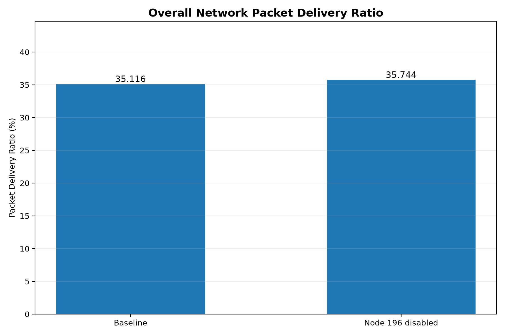
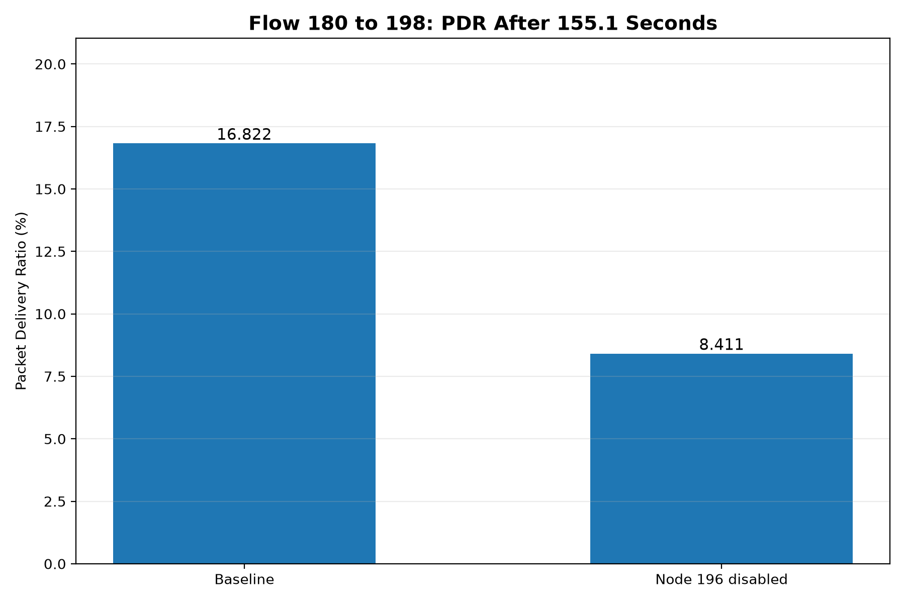
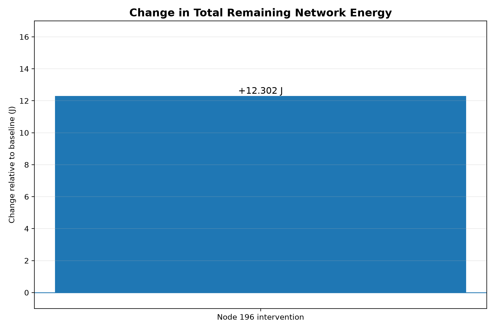
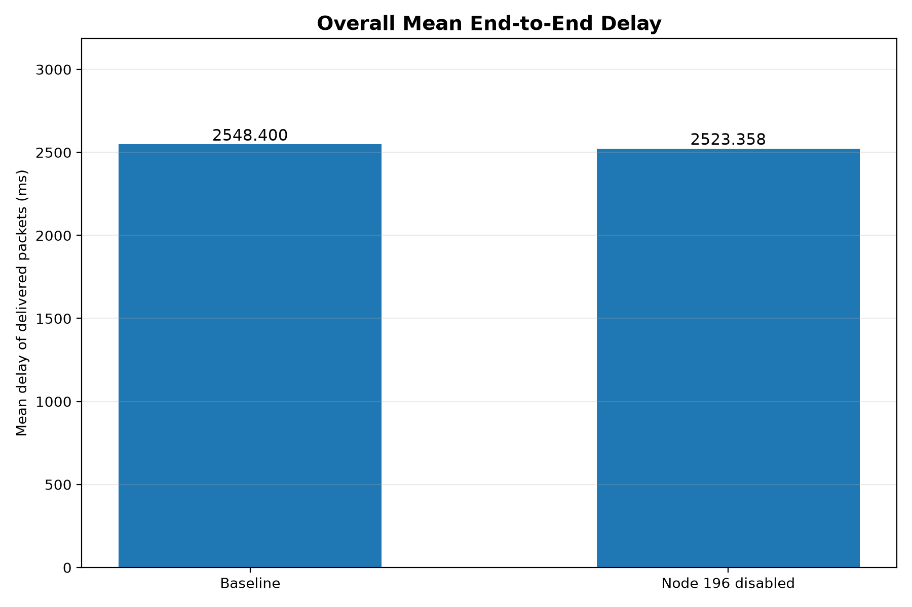

# Phase 3 — AI-Based Preventive Network Management

## 1. Project Overview

This project investigates AI-assisted preventive network management
using Network Simulator 2 (NS2) and Random Forest.

The simulated network contains 250 wireless nodes, uses AODV routing,
and generates UDP/CBR traffic.

## 2. AI Prediction System

- Model: Random Forest
- Prediction horizon: 15 seconds
- Experimental low-energy threshold: 45 J
- Input features: energy, energy decay, energy consumed

In the full-network run at the 150-second checkpoint,
Random Forest identified all six future low-energy nodes correctly.

Random Forest accuracy: 100% at this checkpoint.
Linear forecasting accuracy: 100% at this checkpoint.

This does not establish superiority over linear forecasting or
generalization to all network configurations.

## 3. NS2 Integration

Python was invoked during an actual 250-node NS2 simulation.

The integrated system performed:

1. Node energy monitoring
2. Random Forest prediction
3. Routing activity analysis
4. Safety-policy evaluation
5. Decision handoff to NS2

The controller returned NO_ACTION.

Automatic node shutdown was not enabled.

## 4. Relay Candidate Discovery

At 155 seconds:

- Predicted low-energy nodes: 159
- Observed CBR forwarding nodes: 51
- Matching low-energy relay candidates: 19
- Traffic endpoints among candidates: 7
- Intermediate relay candidates: 12

Node 196 was selected for a separate controlled experiment.

## 5. Controlled Node 196 Experiment

Node 196 was disabled at 155.1 seconds in an isolated simulation.

This was an experimenter-defined intervention,
not an autonomous AI-selected action.

### Performance Comparison

| Metric | Baseline | Node 196 Disabled |
|---|---:|---:|
| Network PDR (%) | 35.116 | 35.744 |
| Mean delay (ms) | 2548.400 | 2523.358 |
| Remaining energy (J) | 9143.232 | 9155.534 |
| Affected-flow PDR after 155.1 s (%) | 16.822 | 8.411 |

### Changes

- Overall PDR: +0.628 percentage points
- Mean delay: -25.041 ms
- Remaining energy: +12.302 J
- Affected-flow PDR: -8.411 percentage points

The intervention improved aggregate packet delivery but
substantially reduced delivery for Flow 180 to 198.

Delay is calculated only from successfully delivered packets.

## 6. Post-Intervention Routing

After Node 196 was disabled, packets still reached Node 198.

Recorded forwarding sequences included:
- Node 197
- Nodes 178, 228, and 244
- Longer sequences involving Nodes 243, 214, and 245

These are observed forwarding sequences, not independently
verified complete end-to-end routes.

For Flow 180 to 198, 18 of 214 packets generated
after the intervention were delivered.

## 7. Safety Evaluation

Retrospective safety assessment: BLOCK_AUTO_SHUTDOWN

Reason: Excessive packet-delivery loss on an affected flow.

The 2-percentage-point flow-PDR loss limit is a proposed
experimental safeguard, not an established networking standard.

These post-intervention results were not available to the
AI controller before the shutdown.

## 8. Key Findings

1. AI inference can operate during an NS2 simulation.
2. Random Forest can forecast future low-energy conditions.
3. Simple linear forecasting also performed well.
4. Predicted low-energy relays can be identified from real traces.
5. Removing a relay may improve aggregate metrics while
   harming individual traffic flows.
6. Routing-aware safety checks are necessary before intervention.

## 9. Limitations

- The experiment used a simulated wireless network.
- The 45 J threshold represents low simulated energy,
  not a measured physical device failure.
- The reported 100% prediction accuracy is checkpoint-specific.
- A single controlled shutdown does not establish broad
  statistical reliability.
- The completed node shutdown was experimenter-defined.
- Safe, autonomous AI-selected interventions have not
  yet been demonstrated.

## 10. Final Conclusion

The project demonstrates an in-simulation AI decision-support
system that combines energy prediction with routing observations.

The results highlight the importance of evaluating
per-flow reliability alongside aggregate network metrics.

Autonomous performance-improving interventions remain
future work.

## 11. Figures

## 12. Supporting Evidence

- output/node196_comparison.csv
- output/node196_safety_review.json
- output/relay_candidates_155.csv
- output/node196_packet_paths.csv
